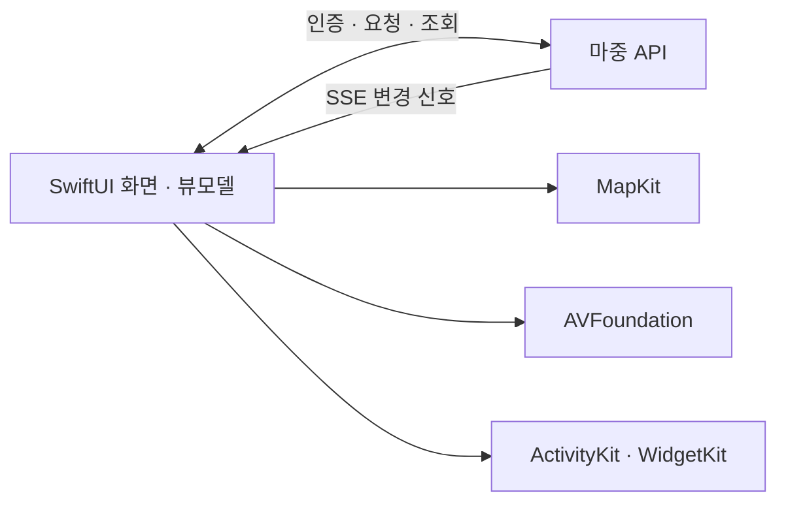

<div align="center">
  
  <h1>마중 iOS</h1>
  <p>데리러 오는 차량의 도착 시간과 만날 장소를 iPhone에서 확인한다.</p>
  <p><a href="https://github.com/majung-team/majung">서비스 소개</a> · <a href="https://www.figma.com/design/XfEx8dmI2KqQuFZQAtpm0I/Majung?node-id=170-3">Figma</a> · <a href="https://app.notion.com/p/4146da9ae26a81f8b525ece0ed1c1962">기획 문서</a> · <a href="https://github.com/majung-team/majung/wiki">기술 회고</a></p>
</div>

## 초대받고, 준비하고, 만날 때까지

가족이나 친구가 차로 데리러 올 때 사용하는 탑승자 앱이다. 초대 링크로 참여하면 만날 장소와 차량 위치·도착 시간을 확인하고, 준비 상태와 메시지를 보낼 수 있다. 로그인 후 운전자를 검색해 먼저 마중을 요청할 수도 있다.

| 이용 단계 | 앱에서 할 수 있는 일 |
| --- | --- |
| 참여 | 로그인 없이 초대 장소 확인·참여, 대기 중 나가기 |
| 요청 | 카카오 로그인·닉네임 설정·사람 연결, 장소 검색 후 마중 요청 |
| 대기·진행 | 내 픽업 차례와 차량 위치·도착 시간 확인 |
| 소통 | 준비 중·완료 전송, 짧은 메시지·다른 만날 장소 제안 |
| 도착·종료 | 도착 안내, 탑승 완료·취소 결과 확인과 알림 정리 |

차량 계정 연결은 카메라 QR 스캔 또는 링크 입력으로 진행한다. 이용 흐름이 헷갈리면 로그인·홈의 `?`와 설정에서 가이드를 다시 열 수 있다. 앱은 현재 App Store 배포 전이다.

## 앱을 나갔을 때의 도착 시간

ActivityKit·WidgetKit으로 잠금화면과 다이나믹 아일랜드에 픽업 현황을 표시한다. 현황을 누르면 `majung://pickup`으로 해당 픽업 화면을 연다.

이 표시는 **마지막으로 받은 차량 정보**를 기준으로 한다. 유효 시간이 지나면 갱신이 필요하다고 안내하며, 앱이 백그라운드에 있는 동안 서버 정보가 계속 수신되는 기능으로 설명하지 않는다. APNs 원격 갱신과 유니버설 링크의 실기기 검증은 별도 범위다.

## Xcode에서 실행하기

**Xcode 16 이상 · iOS 17 이상**을 기준으로 한다. Xcode의 `Majung.xcodeproj`를 열고 **Majung** 스킴과 설치된 iPhone 시뮬레이터를 선택해 실행한다. 시뮬레이터 빌드에는 배포 서명이 필요하지 않다.

```sh
xcodebuild -project Majung.xcodeproj -scheme Majung \
  -destination 'generic/platform=iOS Simulator' \
  CODE_SIGNING_ALLOWED=NO build
```

기본 API 주소는 `https://majung.cloud/api/v1`이다. 카카오 로그인은 시스템 인증 브라우저로 진행하며, 초대 링크로 참여하는 흐름은 로그인 없이도 이용할 수 있다. 카메라 QR 읽기와 실제 카카오 앱 전환은 iPhone에서 따로 확인해야 한다.

```sh
# 설치된 시뮬레이터의 이름 또는 UUID 확인
xcrun simctl list devices available

# 선택한 UUID로 단위·UI 검사 실행
xcodebuild -project Majung.xcodeproj -scheme Majung \
  -destination 'platform=iOS Simulator,id=<시뮬레이터 UUID>' \
  CODE_SIGNING_ALLOWED=NO \
  -only-testing:MajungTests -only-testing:MajungUITests test
```

`<시뮬레이터 UUID>`는 위 목록의 실제 값으로 바꾼다. 운영 차량 연동 시험은 일반 UI 시험과 별도로 명시적으로 실행한다. [운영 연동 검사 조건](docs/operating-rehearsal.md)

## 화면과 상태를 나누는 방식

- **SwiftUI·Observation** — 계정·차량 연결·마중 요청·픽업을 기능별 화면과 뷰모델로 구성한다.
- **MapKit·서버 장소 검색** — 서버의 장소·주소 검색을 사용하고, 사용할 수 없는 환경에서는 MapKit 검색으로 전환한다.
- **SSE·API 조회** — 변경 신호가 오면 API를 다시 읽어 상태를 맞춘다. 지도와 도착 시간에는 유효한 차량 정보만 반영한다.
- **AuthenticationServices·AVFoundation** — 카카오 인증 브라우저와 차량 QR 스캔을 담당한다.
- **UserNotifications·ActivityKit** — 도착 안내와 로컬 실시간 현황을 표시하고, 종료된 픽업의 알림을 정리한다.



<details>
<summary>프로젝트에서 코드 찾기</summary>

| 경로 | 역할 |
| --- | --- |
| `Majung/App/` | 앱 진입점·화면 전환·알림 등록 |
| `Majung/Core/` | API 클라이언트·SSE·입력 검증 |
| `Majung/DesignSystem/` | 공통 카드·버튼·검색·지도 컴포넌트 |
| `Majung/Features/` | 이용 가이드·계정·차량 연결·마중 요청·픽업 |
| `MajungLiveActivity/` | 잠금화면·다이나믹 아일랜드 확장 |
| `MajungTests/`, `MajungUITests/` | 단위·UI 검사와 명시적 운영 연동 검사 |

</details>

## 확인한 환경

단위 시험과 내장 시험 서버 기반 UI 흐름, 운영 차량↔iPhone 시뮬레이터의 ETA·메시지·장소 제안·취소·완료를 확인한 기록이 있다. 실행별 성공 여부는 [iOS CI](https://github.com/majung-team/majung-ios/actions/workflows/ios.yml)와 [운영 연동 기록](docs/operating-rehearsal.md)을 기준으로 한다. 새로 추가한 시험을 곧바로 통과한 시험으로 집계하지 않는다.

실제 iPhone의 최초 카카오 로그인·카메라 QR·실주행·원격 푸시·유니버설 링크는 시뮬레이터 결과로 대체하지 않는다.

[화면 설계](https://app.notion.com/p/4146da9ae26a8064b544d805ddc1b578) · [전체 아키텍처](https://github.com/majung-team/majung/blob/main/docs/architecture.md) · [개발 기록](https://github.com/majung-team/majung/blob/main/docs/development-status.md) · [기여 가이드](CONTRIBUTING.md)
