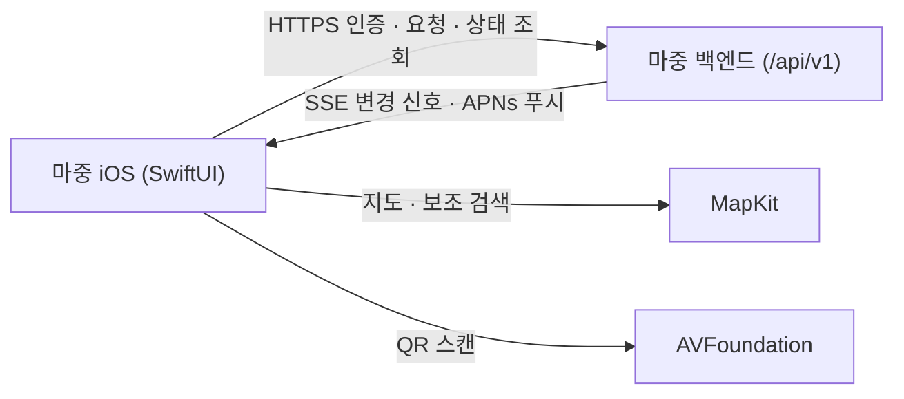

<div align="center">
  
  <h1>마중 iOS (Majung iOS)</h1>
  <p>가족이나 친구가 차로 데리러 올 때, 만날 장소와 실시간 차량 위치·도착 예정 시간·탑승 준비 상태를 함께 확인하는 iOS 앱입니다.</p>
  <p>
    <a href="https://app.notion.com/p/4146da9ae26a81f8b525ece0ed1c1962">Notion</a> ·
    <a href="https://www.figma.com/design/XfEx8dmI2KqQuFZQAtpm0I/Majung?node-id=170-3">Figma</a> ·
    <a href="https://majung.cloud">모바일 웹</a> ·
    <a href="https://github.com/majung-team/majung">마중 프로젝트</a> ·
    <a href="https://github.com/majung-team/majung/wiki">Wiki</a> ·
    <a href="https://github.com/majung-team/majung/blob/main/docs/development-status.md">개발 현황</a>
  </p>
</div>

> 현재 시뮬레이터와 로컬 테스트 서버 중심으로 기능을 검증했으며, 실기기 푸시(APNs) 및 유니버설 링크는 Apple Developer 계정 프로비저닝 시 활성화됩니다.

---

## 1. 주요 기능

### 참여 · 계정 · 차량 연결
- **초대 링크 게스트 참여**: 로그인 없이 전달받은 초대 링크로 만날 장소를 먼저 확인한 뒤 바로 참여하거나 대기 중에 나갈 수 있습니다.
- **카카오 로그인 · 지인 연결**: 인앱 브라우저(`ASWebAuthenticationSession`) 기반 카카오 로그인과 닉네임·마중 ID 설정, 지인 검색·연결, 회원 탈퇴를 지원합니다.
- **차량 QR 연결**: `AVFoundation` 카메라 QR 스캔 또는 링크 입력으로 운전자 차량과 손쉽게 연결하고 해제할 수 있습니다.

### 장소 검색 · 실시간 소통
- **장소 · 주소 검색**: 서버의 카카오 로컬 검색으로 상호명과 도로명·지번 주소를 찾아주며, 서버 검색을 쓸 수 없는 환경에서는 Apple 지도(`MKLocalSearch`) 검색으로 자동 전환합니다.
- **실시간 위치 · 소통**: 실시간 연결(SSE)로 차량 위치와 도착 예정 시간을 받아보고, 탑승 준비 상태·빠른 메시지 전달 및 만날 장소 변경을 제안합니다.

### 알림 · 화면 테마
- **도착 알림 · 다크 모드**: 라이트·다크 모드를 지원하며, 앱 내 도착 임박·도착 로컬 알림과 APNs 원격 푸시 연동을 제공합니다.

---

## 2. 시스템 구성 및 기술 스택



### 패키지 구조

```text
Majung/
├── App/           # 앱 진입점 · 푸시 등록(AppDelegate) · 루트 화면 전환(ContentView)
├── Core/          # 백엔드 API 클라이언트(계정·픽업·요청·차량 연결) · SSE 파서
├── DesignSystem/  # 브랜드 컬러(#2669DD)·심볼 및 공통 카드·검색·지도 컴포넌트
└── Features/      # Onboarding · Account · VehicleLinks · RideRequest · Pickup 화면/뷰모델
MajungTests/       # 모델 · 검증기 · SSE · 위치 추적 단위 테스트
MajungUITests/     # 내장 테스트 서버 기반 UI E2E 테스트
```

### 기술 스택

| 구분 | 구성 |
| --- | --- |
| **앱 프레임워크** | Swift · SwiftUI · Swift Observation (`@Observable`) · iOS 17.0+ |
| **지도 · 스캔** | MapKit · CoreLocation · `AVFoundation` (`AVCaptureSession` QR 스캔) |
| **인증 · 알림** | AuthenticationServices (PKCE OAuth) · UserNotifications · APNs |
| **검증 · CI** | XCTest (`MajungTests`) · XCUITest (`MajungUITests`) · GitHub Actions |

---

## 3. 검증 범위 및 남은 확인 사항

| 구분 | 범위 |
| --- | --- |
| **확인 완료** | `MajungTests`(26개) · 내장 테스트 서버 `MajungUITests`(6개)<br>[iOS CI](https://github.com/majung-team/majung-ios/actions/workflows/ios.yml) 시뮬레이터 빌드 |
| **추후 확인** | iPhone 실기기 카카오 로그인·카메라 QR 스캔·실주행 연동<br>유료 Apple Developer 프로비저닝 후 APNs 원격 푸시·유니버설 링크 검증 |

---

## 4. 상세 문서 및 관련 저장소

| 분류 | 문서 |
| --- | --- |
| **기획 · 디자인** | [Notion 홈](https://app.notion.com/p/4146da9ae26a81f8b525ece0ed1c1962) · [화면 설계와 이용 흐름](https://app.notion.com/p/4146da9ae26a8064b544d805ddc1b578) · [데이터 모델과 ERD](https://app.notion.com/p/4146da9ae26a809b928cffed612504f4) · [로드맵 · 체크리스트](https://app.notion.com/p/4146da9ae26a80d6bb0fe7bab3c929e2) · [Figma 디자인](https://www.figma.com/design/XfEx8dmI2KqQuFZQAtpm0I/Majung?node-id=170-3) |
| **프로젝트 문서** | [사용 안내 · 기술 회고 (Wiki)](https://github.com/majung-team/majung/wiki) · [개발 현황 및 PR 근거](https://github.com/majung-team/majung/blob/main/docs/development-status.md) · [시스템 아키텍처](https://github.com/majung-team/majung/blob/main/docs/architecture.md) · [기여 가이드](CONTRIBUTING.md) |

| 저장소 | 역할 |
| --- | --- |
| [majung](https://github.com/majung-team/majung) | 전체 서비스 소개 · 설계 · 시연 |
| [majung-vehicle-app](https://github.com/majung-team/majung-vehicle-app) | AAOS 차량 앱 및 Pleos SDK 연동 |
| [majung-web](https://github.com/majung-team/majung-web) | 운전자 · 탑승자 모바일 웹 |
| [majung-ios](https://github.com/majung-team/majung-ios) | SwiftUI iOS 모바일 앱 |
| [majung-backend](https://github.com/majung-team/majung-backend) | Spring Boot API 및 운영 배포 |
