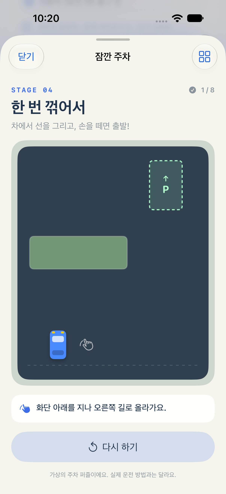
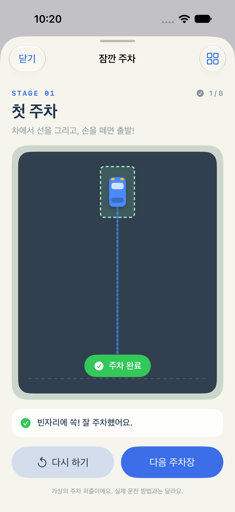

# 잠깐 주차

로그인 화면이나 홈에서 열어 혼자 플레이하는 경로 그리기 퍼즐. 픽업을 기다리는 동안이 아니어도 이용할 수 있다.

- 파란 차에서 선을 그린 뒤 손을 떼면 이동
- 장애물이나 주차장 경계에 닿으면 출발점으로 복귀
- 짧게 그렸거나 이동을 멈췄다면 현재 위치에서 이어 그리기
- 주차 칸 안에 차체 전체가 들어가고 방향이 맞으면 완료
- 스테이지 8개 자유 선택, 완료한 스테이지만 기기에 저장
- 화면 닫기·다른 앱 전환·스테이지 변경 시 이동 중단

친구 목록, 온라인 랭킹, 기록 공유는 구현 범위에서 제외했다. 기존 인증·픽업 API를 추가하거나 변경하지 않는다.

## 코드

| 파일 | 역할 |
| --- | --- |
| `Majung/Features/ParkingGame/ParkingPuzzle.swift` | 스테이지, 이동 경로, 차체 충돌·주차 판정, 완료 여부 저장 |
| `Majung/Features/ParkingGame/ParkingGameView.swift` | 진입 카드, 게임 화면, 이동 작업과 화면 이탈 처리 |
| `MajungTests/ParkingPuzzleTests.swift` | 전체 스테이지 풀이, 차체 충돌, 주차 방향, 중단, 로컬 저장 검사 |
| `MajungUITests/ParkingGameUITests.swift` | 로그인 전·홈 진입, 경로 그리기, 완료·스테이지 선택, 충돌·재시작 검사 |

## 확인 기록 · 2026-11-16

Xcode 27.2, iOS 27.2의 iPhone 18 Pro 시뮬레이터에서 확인했다.

- 시뮬레이터 빌드 성공
- 기존 검사 포함 단위 테스트 47개 통과
- 새 게임 UI 테스트 2개 통과
- 로컬 E2E 서버의 예시 계정 사용, 운영 서버 이용·실기기 검증 제외
- 기존 전체 UI 테스트는 로컬 실행 범위에 미포함

| 장애물 스테이지 | 첫 주차 완료 |
| --- | --- |
|  |  |
