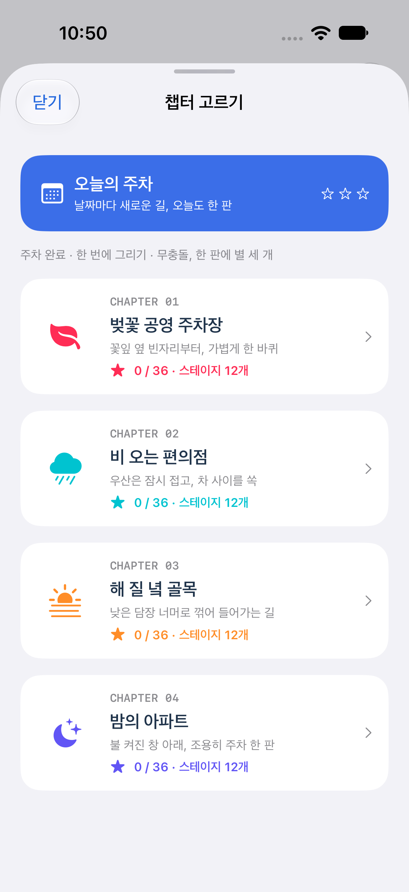
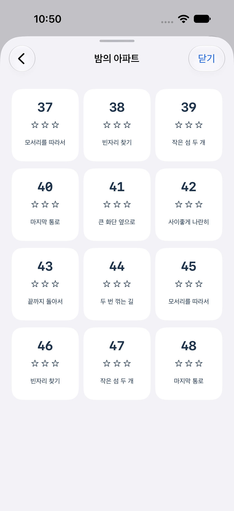
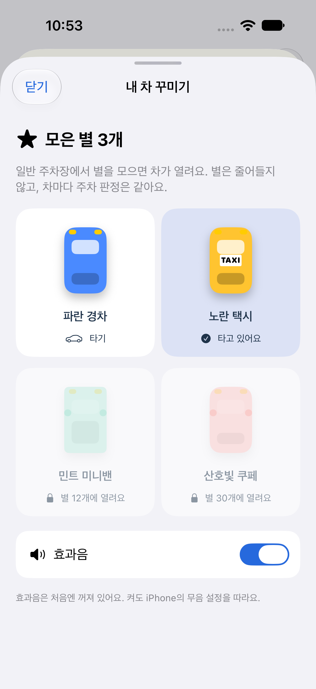

# 잠깐 주차

로그인 화면이나 홈에서 열어 혼자 플레이하는 경로 그리기 퍼즐. 픽업을 기다리는 동안이 아니어도 이용할 수 있다.

## 챕터와 주차

처음 열면 챕터 선택 화면으로 진입한다. 챕터별 스테이지 12개, 총 48개를 순서 제한 없이 고를 수 있다.

| 챕터 | 스테이지 | 배경 |
| --- | --- | --- |
| 벚꽃 공영 주차장 | 1–12 | 꽃잎과 화단 |
| 비 오는 편의점 | 13–24 | 빗자국과 편의점 간판 |
| 해 질 녘 골목 | 25–36 | 노을빛 담장 |
| 밤의 아파트 | 37–48 | 불 켜진 창과 달 |

차에서 선을 그리고 손을 떼면 이동한다. 차체가 장애물이나 주차장 경계에 닿으면 출발점으로 돌아간다. 짧게 그렸거나 이동을 멈췄다면 현재 위치에서 이어 그릴 수 있다. 차체 전체가 주차 칸 안에 들어가고 앞쪽이 위를 향하면 완료한다. 실제 조향·후진을 재현하는 운전 시뮬레이터는 아니다.

## 별과 내 차

스테이지마다 아래 세 도전을 기록한다. 시간 제한은 없다.

- 주차 완료: 주차 칸에 도착
- 한 번에: 손을 한 번만 떼고 주차 완료
- 무충돌: 부딪히지 않고 주차 완료

한 번 달성한 도전은 이후 결과가 낮아도 유지한다. 같은 판을 반복해도 같은 별이 중복으로 늘지 않는다. 다시 하기는 새 도전으로 시작한다. 최초 버전에서 완료한 스테이지는 완료 별 1개를 유지한다.

| 차 | 해제 조건 |
| --- | --- |
| 파란 경차 | 처음부터 이용 |
| 노란 택시 | 일반 스테이지 별 3개 |
| 민트 미니밴 | 일반 스테이지 별 12개 |
| 산호빛 쿠페 | 일반 스테이지 별 30개 |

차를 골라도 별을 소모하지 않는다. 차의 외형만 다르고 이동 속도·충돌·주차 판정은 같다. 선택한 차와 별 기록은 앱을 다시 열어도 유지한다.

## 오늘의 주차와 효과

오늘의 주차는 기기의 현지 날짜를 기준으로 검증된 스테이지를 선택하고 좌우 배치·테마를 변형한다. 같은 날짜의 판은 다시 열어도 같다. 날짜가 바뀐 상태에서 진행 중인 판은 갑자기 교체하지 않으며, 챕터 화면에서 오늘의 주차를 다시 고르면 새 날짜를 적용한다.

오늘의 별은 날짜별로 따로 저장하며 차량 해제에 합산하지 않는다. 현재 선택한 날짜와 최근 날짜 기록을 최대 30개 보관한다. 연속 출석이나 놓친 날짜에 대한 불이익은 없다.

- 장애물 가까이에서 사이드미러 접기와 짧은 진동, 경로당 한 번만 근접 진동
- 충돌 시 작은 시각 반응과 경고 진동, 주차 성공 시 전조등 두 번 깜빡임과 성공 진동
- 내 차 꾸미기의 효과음 스위치, 기본 꺼짐·iPhone 무음 모드 준수·다른 오디오와 혼합
- 동작 줄이기 설정 시 장식 애니메이션 축소
- 화면 닫기·다른 앱 전환·스테이지 변경 시 이동 작업과 효과음 중단

친구 목록·온라인 랭킹·공유는 구현 범위에서 제외했다. 인증·픽업 API 및 서버·웹·차량 저장소 변경 없이 iOS 기기에만 저장한다.

## 코드

| 파일 | 역할 |
| --- | --- |
| `ParkingPuzzle.swift` | 챕터·스테이지·오늘의 판, 차체 충돌·주차·별 판정, 기록·차량·설정 저장 |
| `ParkingGameView.swift` | 진입 카드·챕터·게임·차고 화면, 이동 작업과 화면 이탈 처리 |
| `ParkingBoard.swift` | 주차장 테마·차량 외형·근접과 성공 시각 효과 |
| `ParkingEffects.swift` | 짧은 효과음 생성·오디오 세션 종료 |
| `ParkingPuzzleTests.swift` | 전체 판 풀이, 충돌·별·기록 이전·보상 중복·날짜별 재현성 검사 |
| `ParkingGameUITests.swift` | 챕터·게임·차고·오늘의 주차 화면 조작 검사 |

## 확인 기록 · 2026-11-16

Xcode 27.2, iOS 27.2의 iPhone 18 Pro 시뮬레이터에서 확인했다. 단위 검사에는 스테이지 48개와 366일치 오늘의 주차 풀이, 기존 완료 기록 유지, 보상 중복 방지, 차량 해제·설정 재로딩을 포함한다.

UI 검사는 로컬 E2E 서버의 예시 계정을 사용한다. 운영 서버·실기기 검증 및 실제 진동·무음 모드의 청감 확인은 범위에 포함하지 않는다.

- 단위 테스트 53개 통과: 기존 39개와 게임 검사 14개
- 게임 UI 테스트 3개 통과: 챕터·마지막 스테이지·오늘의 주차, 충돌·재시작, 별·차량 해제·선택·효과음 설정 재로딩
- 기존 UI 테스트 2개 통과: 로그인 진입·도움말, 게스트 픽업 준비 상태·메시지·장소 제안·완료
- 전체 UI 테스트 및 GitHub Actions 완료 대기는 로컬 확인 범위에 미포함

| 챕터 선택 | 챕터 안의 스테이지 |
| --- | --- |
|  |  |

| 내 차 꾸미기 | 오늘의 주차 |
| --- | --- |
|  |  |
