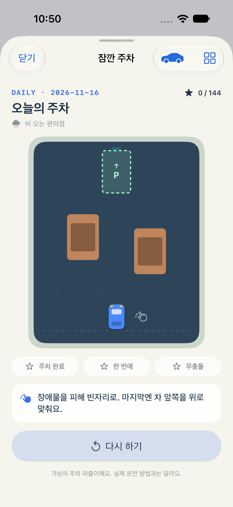
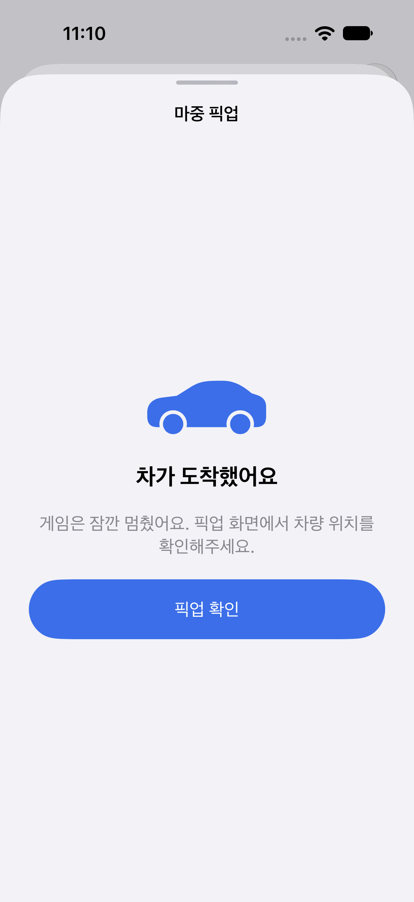
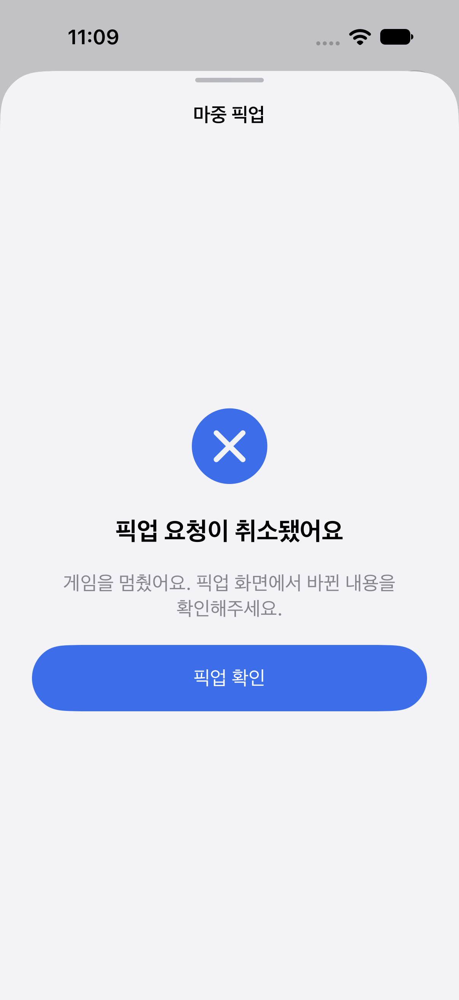

# 잠깐 주차

로그인 화면·홈·픽업 화면에서 열어 혼자 플레이하는 경로 그리기 퍼즐. 픽업을 기다리는 동안이 아니어도 이용할 수 있다.

## 챕터와 주차

처음 열면 챕터 선택 화면으로 진입한다. 챕터별 스테이지 12개, 총 48개를 순서 제한 없이 고를 수 있다.

| 챕터 | 스테이지 | 배경 |
| --- | --- | --- |
| 벚꽃 공영 주차장 | 1–12 | 꽃잎과 화단 |
| 비 오는 편의점 | 13–24 | 빗자국과 편의점 간판 |
| 해 질 녘 골목 | 25–36 | 노을빛 담장 |
| 밤의 아파트 | 37–48 | 불 켜진 창과 달 |

차에서 선을 그리고 손을 떼면 이동한다. 차체가 장애물이나 주차장 경계에 닿으면 출발점으로 돌아간다. 짧게 그렸거나 이동을 멈췄다면 현재 위치에서 이어 그릴 수 있다. 차체 전체가 주차 칸 안에 들어가고 앞쪽이 위를 향하면 완료한다. 실제 조향·후진을 재현하는 운전 시뮬레이터는 아니다.

## 별과 내 차

스테이지마다 아래 세 도전을 기록한다. 시간 제한은 없다.

- 주차 완료: 주차 칸에 도착
- 한 번에: 손을 한 번만 떼고 주차 완료
- 무충돌: 부딪히지 않고 주차 완료

한 번 달성한 도전은 이후 결과가 낮아도 유지한다. 같은 판을 반복해도 같은 별이 중복으로 늘지 않는다. 다시 하기는 새 도전으로 시작한다. 최초 버전에서 완료한 스테이지는 완료 별 1개를 유지한다.

| 차 | 해제 조건 |
| --- | --- |
| 파란 경차 | 처음부터 이용 |
| 노란 택시 | 일반 스테이지 별 3개 |
| 민트 미니밴 | 일반 스테이지 별 12개 |
| 초록 픽업트럭 | 일반 스테이지 별 18개 |
| 보라 SUV | 일반 스테이지 별 24개 |
| 산호빛 쿠페 | 일반 스테이지 별 30개 |
| 작은 캠핑카 | 일반 스테이지 별 48개 |
| 크림 클래식카 | 일반 스테이지 별 60개 |
| 빨간 로드스터 | 일반 스테이지 별 90개 |
| 주황 배송밴 | 일반 스테이지 별 120개 |

차고 상단에는 큰 미리보기와 현재 타는 차를 표시한다. 하단의 작은 차량 카드를 누르면 미리보기만 바뀐다. 잠긴 차도 구경할 수 있지만 `이 차 타기`는 해제한 차량에서만 활성화된다. 미리 본 뒤 그냥 닫으면 기존 차량을 유지한다. 차고를 다시 열면 현재 타는 차를 미리 보고 목록도 그 차량 위치로 이동한다.

차를 골라도 별을 소모하지 않는다. 차의 외형만 다르고 이동 속도·충돌·주차 판정은 같다. 선택한 차와 별 기록은 앱을 다시 열어도 유지한다.

## 오늘의 주차와 효과

오늘의 주차는 기기의 현지 날짜를 기준으로 검증된 스테이지를 선택하고 좌우 배치·테마를 변형한다. 같은 날짜의 판은 다시 열어도 같다. 날짜가 바뀐 상태에서 진행 중인 판은 갑자기 교체하지 않으며, 챕터 화면에서 오늘의 주차를 다시 고르면 새 날짜를 적용한다.

오늘의 별은 날짜별로 따로 저장하며 차량 해제에 합산하지 않는다. 현재 선택한 날짜와 최근 날짜 기록을 최대 30개 보관한다. 연속 출석이나 놓친 날짜에 대한 불이익은 없다.

- 장애물 가까이에서 사이드미러 접기와 짧은 진동, 경로당 한 번만 근접 진동
- 충돌 시 작은 시각 반응과 경고 진동, 주차 성공 시 전조등 두 번 깜빡임과 성공 진동
- 내 차 꾸미기의 효과음 스위치, 기본 꺼짐·iPhone 무음 모드 준수·다른 오디오와 혼합
- 동작 줄이기 설정 시 장식 애니메이션 축소
- 화면 닫기·다른 앱 전환·스테이지 변경 시 이동 작업과 효과음 중단

친구 목록·온라인 랭킹·공유는 구현 범위에서 제외했다. 인증·픽업 API 및 서버·웹·차량 저장소 변경 없이 iOS 기기에만 저장한다.

## 픽업을 기다리며 플레이할 때

초대 링크로 참여했거나 로그인 후 마중을 요청했다면, 픽업 화면 오른쪽 위 `잠깐 주차` 버튼으로 연다. 게임을 닫으면 기존 픽업 화면으로 돌아간다. 게임을 열고 닫는 동작은 요청 취소·준비 상태 변경·탑승 완료를 호출하지 않는다.

기존 픽업의 위치·도착 시간 조회와 이벤트 수신 작업은 게임을 띄워도 유지한다. 차량 도착·요청 취소·완료·만료·연결 오류가 확인되면 이동과 효과음을 중단하고 안내 화면으로 전환한다. 챕터 선택이나 차고를 보고 있더라도 안내 화면을 표시한다. `픽업 확인`을 누르면 게임을 닫고 현재 픽업 상태를 확인할 수 있다. 상태가 잠시 되돌아와도 게임을 자동으로 재개하지 않는다.

이미 차량이 도착했거나 픽업이 종료된 화면에서는 게임 진입 버튼을 비활성화한다. 게임에서 복귀하는 동작은 다른 화면으로 강제 이동하거나 요청을 새로 생성하지 않는다.

## 코드

| 파일 | 역할 |
| --- | --- |
| `ParkingPuzzle.swift` | 좌표·차체 충돌·주차 판정과 주행 시뮬레이션 엔진 |
| `ParkingStages.swift` | 챕터·스테이지 48개·테마·오늘의 주차 생성 |
| `ParkingProgressStore.swift` | 별 보상·차량 10종 정의·로컬 기록 및 설정 저장소 |
| `ParkingGameModel.swift` | 게임 상태 관리·이동 작업·픽업 중단 안내 모델 |
| `ParkingGameView.swift` | 진입 카드·챕터·게임 화면과 화면 이탈 처리 |
| `ParkingGarageView.swift` | 큰 미리보기·스크롤 가능한 차량 목록·명시적 탑승·효과음 설정 |
| `ParkingBoard.swift` | 주차장 테마·차량 외형·근접과 성공 시각 효과 |
| `ParkingEffects.swift` | 짧은 효과음 생성·오디오 세션 종료 |
| `ParkingPuzzleTests.swift` | 전체 판 풀이, 충돌·별·기록 이전·보상 중복·날짜별 재현성 검사 |
| `ParkingGameUITests.swift` | 챕터·게임·차고·오늘의 주차 화면 조작 검사 |

## 확인 기록 · 2026-11-16

`iPhone 18 Pro` (`iOS 27.0`, 콜드 부팅 시뮬레이터, macOS `27.2.1`)에서 확인했다. 단위 검사에는 스테이지 48개와 366일치 오늘의 주차 풀이, 기존 완료 기록 유지, 보상 중복 방지, 차량 10종 해제 경계·선택 저장·설정 재로딩, 픽업 인터럽트 검사를 포함한다.

UI 검사는 로컬 E2E 서버의 예시 계정을 사용한다. 운영 서버·실기기 검증(라이브 초대 2건) 및 실제 진동·무음 모드의 청감 확인은 로컬 확인 범위에 포함하지 않는다.

- 단위 테스트 `MajungTests` 57개 통과 (`MajungCoreTests` 24개, `ParkingPuzzleTests` 18개, `PickupTrackerTests` 15개)
- 게임 UI 테스트 `ParkingGameUITests` 6개 통과: 챕터·마지막 스테이지·오늘의 주차, 충돌·재시작, 별·차량 해제·선택·효과음 설정 재로딩, 10종 차고 미리보기·잠긴 차량 유지·재진입, 회원 픽업 도착·게스트 픽업 취소 연동
- 기존 UI 테스트 `MajungE2EUITests` 11개 통과 (`test10LiveVehicleRoundTrip`, `test11LiveCancellationWhileTypingAndExpiredInvite` 2건은 라이브 초대 환경변수 미지정 스킵)
- GitHub Actions 전체 PR 및 `main` CI 통과는 PR 검사에서 확인

| 챕터 선택 | 챕터 안의 스테이지 |
| --- | --- |
|  |  |

| 내 차 꾸미기 | 오늘의 주차 |
| --- | --- |
|  |  |

### 픽업 중 게임 연동 · 차고 개편 확인 요약

- 회원 픽업에서 게임을 닫았다 다시 열어도 원래 화면 유지, 차고를 띄운 동안 조회 계속 및 차량 도착 안내로 전환 확인
- 게스트 픽업에서 챕터를 고르는 동안 취소 이벤트 수신, 픽업 확인 후 취소 화면 복귀 확인
- 게임 진입·복귀 과정의 요청 취소 API 호출 없음 확인
- 10종 차량 모두 큰 미리보기 전환·잠긴 차량 탑승 비활성·선택 미확정 닫기 시 기존 차량 유지·효과음 스위치 상태 유지 확인

| 차량 도착 안내 | 요청 취소 안내 |
| --- | --- |
|  |  |
