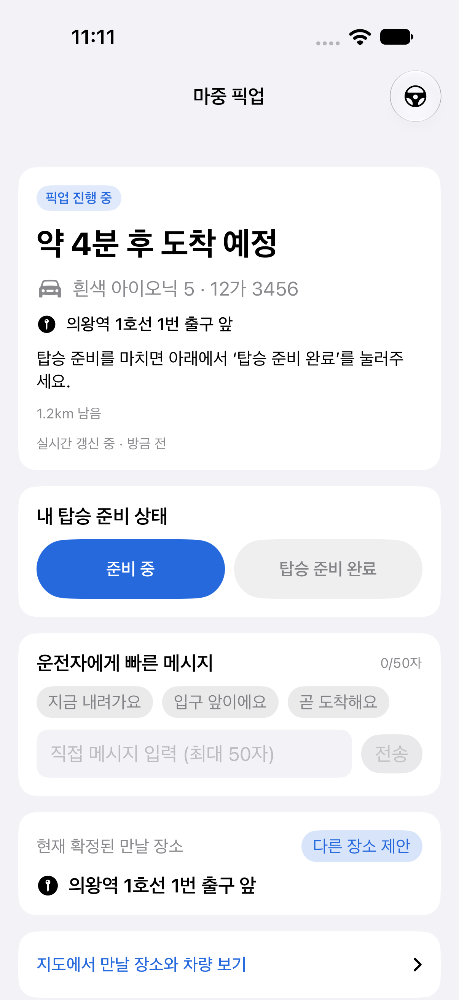
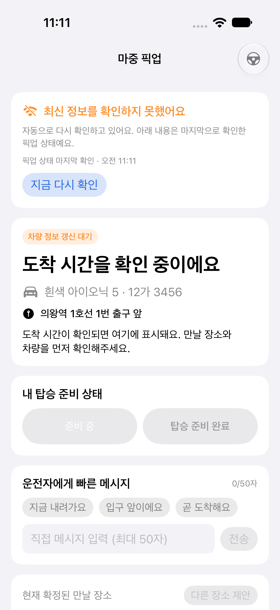
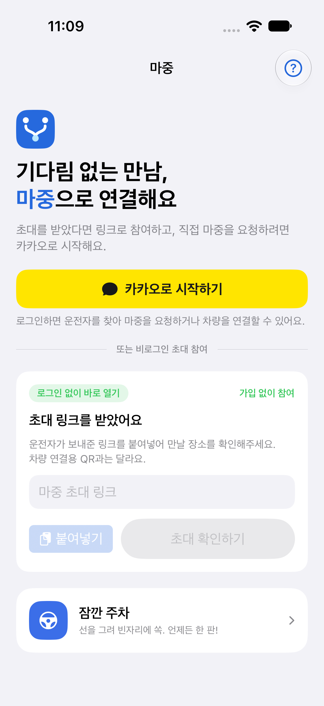
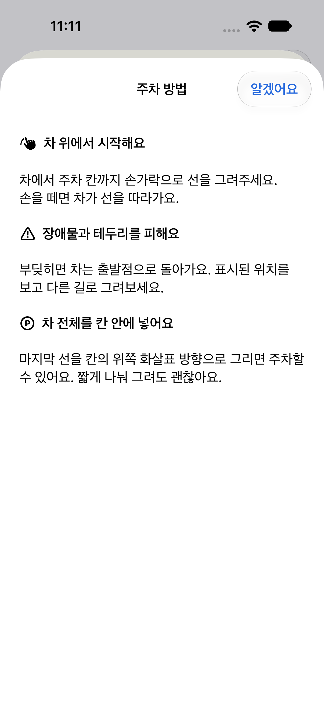

# 픽업 화면과 첫 이용 안내

## 화면에서 달라진 점

- 픽업 중에는 도착 시간·차량·만날 장소를 먼저 표시하고, 준비 상태와 빠른 메시지를 바로 아래에 배치
- 지도는 ‘지도에서 만날 장소와 차량 보기’를 눌러 펼치는 방식으로 변경
- 준비 완료의 차량 전달 여부는 유지하되 내부 순번을 화면 문구에서 제외
- 카카오 로그인, 초대 링크 참여, 운전자의 차량 QR 연결을 첫 화면과 이용 가이드에서 구분

## 정보가 갱신되지 않을 때

차량 정보의 유효 시간이 지나면 기존 도착 시간을 계속 보여주지 않는다. ‘도착 시간을 확인 중이에요’로 바뀌며 차량 정보를 다시 확인할 수 있다.

픽업 상태 조회까지 실패하면 마지막 확인 시각과 재시도 버튼을 표시한다. 이전 픽업 상태는 화면에 남기되, 준비 상태 변경·메시지 전송·장소 제안은 최신 상태를 확인한 후 이용할 수 있다. 작성 중인 메시지는 지우지 않는다. 연결이 복구되면 5초 동안 안내를 표시한다.

‘차량에 전달됐어요’는 차량 앱의 수신 확인이며 운전자가 직접 읽었다는 의미는 아니다.

## 주차 게임

- 차 위에서 선을 시작하는 방법과 주차 성공 조건을 도움말로 제공
- 짧은 선, 장애물 충돌, 주차장 이탈, 차체가 칸 밖에 걸친 상태, 방향 불일치, 미도착을 구분해 안내
- 충돌 시 차를 출발점으로 되돌리되, 실제 충돌 위치에 표시를 남기는 방식 적용
- 다음 선을 그릴 때 이전 충돌 표시 제거
- 픽업 도중 게임과 도움말을 이용해도 픽업 조회 유지
- 차량 도착 시 게임 도움말을 닫고 도착 안내로 전환

## 확인 범위

iPhone 18 Pro / iOS 27.2 시뮬레이터와 로컬 E2E 예시 서버로 확인했다. 실제 차량·운영 서버·APNs 수신을 검증한 결과는 아니다. 서버 API와 웹·차량 앱에는 변경이 없다.

| 픽업 요약 | 연결 재시도 |
| --- | --- |
|  |  |

| 첫 이용 | 주차 방법 |
| --- | --- |
|  |  |
